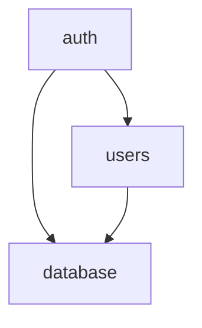

# Backend arch

app.core : core functionnality : auth, users
app.modules : functionnality built on top of core

Core layers (top to bottom):

app.core.auth - support of OAuth2 for authenticating users. depends on app.core.users
app.core.users - operations for creating users in database and checking passwords depends on app.core
app.core.database

